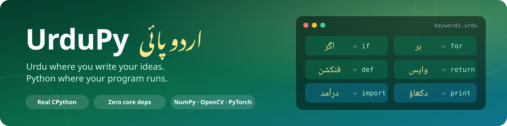
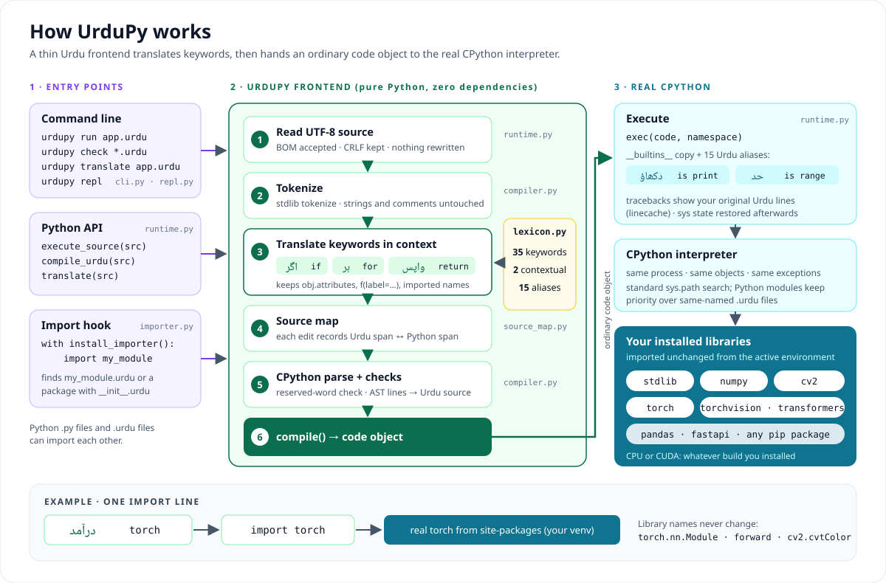

<p align="center">
  
</p>

<p align="center">
  
  
  
  
  
  
</p>

<p align="center">
  <a href="#-quick-start">Quick start</a> ·
  <a href="#-how-it-works">How it works</a> ·
  <a href="#-keyword-cheat-sheet">Keywords</a> ·
  <a href="#-use-any-python-library">Libraries &amp; AI</a> ·
  <a href="docs/README.md">Documentation</a>
</p>

---

**UrduPy** lets you write programs with Urdu keywords, Urdu names and Urdu file
names, then runs them on the **real CPython interpreter**. Your code uses the
same objects, exceptions and installed packages as any Python program: the
standard library, NumPy, OpenCV, PyTorch, Transformers, or anything from pip.

**Run standalone Urdu programs with `اردوپائی`.** Application code does not need
a Python host script or an embedding API. CPython and installed scientific
libraries provide the execution engine underneath.

## مکمل اردو میں کتب خانے

اب ماڈیول، فنکشن، دلائل، ماڈل کے خاص طریقے اور آلے کے نام بھی اردو میں لکھیں۔
فائل کی پہلی سطر سے مکمل اردو انداز منتخب کریں:

```python
# اردوپائی: مکمل
درآمد نمپی
درآمد ٹارچ

اعداد = نمپی.سرنی([1, 2, 3], قسم_اعداد=نمپی.اعشاری۳۲)
دکھاؤ(اعداد.اوسط())

کلاس چھوٹا_ماڈل(ٹارچ.عصبی.جزو):
    فنکشن آغاز(خود):
        بالائی().آغاز()
        خود.تہہ = ٹارچ.عصبی.خطی(3, 1)

    فنکشن آگے(خود, آمد):
        واپس خود.تہہ(آمد)

ماڈل = چھوٹا_ماڈل().منتقل(مرکزی_آلہ)
دکھاؤ(فہرست(ماڈل(ٹارچ.اتفاقی_معمول(2, 3)).شکل))
```

The native arrays, tensors, autograd and optimizers remain those of the installed
libraries. **Readable Urdu spellings** cover common APIs; every additional
identifier or text value has an exact generated Urdu spelling. This gives the
full dependency surface a representation without Latin letters in source;
generated fallback spellings are codepoint names, not human translations.

After installing this checkout, discover names and run an example in Urdu:

```powershell
اردوپائی نام ٹارچ.عصبی
اردوپائی نام نمپی
اردوپائی چلاؤ examples/مکمل_اردو/عددی_حساب.urdu
اردوپائی نصب مصنوعی_ذہانت
```

Read the **[complete Urdu guide](docs/complete-urdu.md)** and the
**[six Urdu-only examples](examples/مکمل_اردو/README.md)**, including ResNet-18,
two optimizers, save/reload, vision, offline language models and an Urdu graph.
Existing files retain their behavior unless they opt into complete Urdu mode.
Dependency messages, returned text and native error types retain their original
values; this feature translates source spellings, not arbitrary third-party prose.

```urdu
# اردوپائی: مکمل
فنکشن مربع(عدد):
    واپس عدد * عدد

ہر عدد میں حد(1, 6):
    اگر عدد % 2 == 0:
        دکھاؤ(عدد, "کا مربع", مربع(عدد), "ہے")
    ورنہ:
        دکھاؤ(عدد, "طاق ہے")
```

This prints five lines. The grammar keeps indentation, `:`,
brackets, operators and expressions are unchanged. The original mode translates
keywords; the opt-in complete mode also translates dependency spellings.

## ✨ Highlights

| | |
|---|---|
| 🔤 **Urdu everywhere you want it** | Keywords, variables, functions, classes, and module/file names (`حساب.urdu`, `اوزار/__init__.urdu`). |
| 🐍 **Real CPython, not an imitation** | Code compiles to ordinary Python bytecode. No new VM, no wrappers, no forks of libraries. |
| 🧠 **AI-ready** | `درآمد ٹارچ`, Urdu model methods and optimizer calls. A saved ResNet-18/STL-10 run reached **77.35%** test accuracy on a GPU. |
| 🔁 **Two-way imports** | `.urdu` files import `.py` modules, and Python programs can import `.urdu` modules. |
| 🎯 **Errors point at your Urdu line** | Tracebacks and syntax errors show the original Urdu source with its own line and column. |
| 🪶 **Zero dependencies** | The core uses only the standard library. Heavy libraries are optional extras. |

## 🚀 Quick start

Clone the repository, then install with CPython **3.12–3.15**:

```powershell
git clone https://github.com/Optimizer077/urdupy.git
cd urdupy
python -m venv .venv
.venv\Scripts\Activate.ps1            # Linux/macOS: source .venv/bin/activate
python -m pip install .               # core only, no dependencies
اردوپائی --نسخہ
```

Save this as `سلام.urdu` (UTF-8):

```python
# اردوپائی: مکمل
نام = ان_پٹ("آپ کا نام؟ ")
دکھاؤ("سلام،", نام)
```

```powershell
اردوپائی چلاؤ سلام.urdu
اردوپائی جانچو سلام.urdu
اردوپائی ترجمہ سلام.urdu
اردوپائی بیٹھک
```

Training arguments can be Urdu too: `--ادوار 50 --آلہ گرافیکی`. More options:
[installation guide](docs/install.md) · [CLI](docs/cli.md).

## 🧩 How it works

<p align="center">
  
</p>

1. **Read & tokenize.** The source is decoded as UTF-8 and tokenized with Python's
   own `tokenize`. Strings and comments are never touched.
2. **Translate in context.** Urdu grammar becomes CPython syntax. Complete Urdu
   mode also resolves library spellings, parameters and native model protocols.
   Strings/comments retain their data; the original mixed mode stays compatible.
3. **Map & compile.** A source map links every edit to the original text. CPython
   parses and compiles, and positions are mapped back to your Urdu lines.
4. **Run.** The code object executes in CPython with a per-module copy of the
   built-ins that adds Urdu aliases such as `دکھاؤ`, which points to the same object as `print`.

The full walkthrough, with pipeline, run-sequence and import diagrams, is in
**[docs/architecture.md](docs/architecture.md)**.

## 📖 Keyword cheat sheet

| Urdu | Python | | Urdu | Python | | Urdu | Python |
|---|---|---|---|---|---|---|---|
| `اگر` | `if` | | `فنکشن` | `def` | | `کوشش` | `try` |
| `ورنہ_اگر` | `elif` | | `واپس` | `return` | | `سوائے` | `except` |
| `ورنہ` | `else` | | `کلاس` | `class` | | `آخرکار` | `finally` |
| `ہر` | `for` | | `درآمد` | `import` | | `اٹھاؤ` | `raise` |
| `میں` | `in` | | `سے` | `from` | | `ساتھ` | `with` |
| `جب_تک` | `while` | | `بطور` | `as` | | `تصدیق` | `assert` |
| `روکو` | `break` | | `سچ` | `True` | | `حذف` | `del` |
| `جاری` | `continue` | | `جھوٹ` | `False` | | `عالمی` | `global` |
| `گزر` | `pass` | | `کچھ_نہیں` | `None` | | `غیر_مقامی` | `nonlocal` |
| `اور` | `and` | | `ہے` | `is` | | `لامبڈا` | `lambda` |
| `یا` | `or` | | `پیدا_کرو` | `yield` | | `غیر_متزامن` | `async` |
| `نہیں` | `not` | | `انتظار` | `await` | | | |

<details>
<summary><b>Contextual keywords and the 15 built-in aliases</b></summary>

**Contextual** (keywords only inside a `match` statement, ordinary names elsewhere):
`منتخب` → `match`, `صورت` → `case`.

**Built-in aliases** are ordinary names for the real built-in objects, so you can
shadow them like any Python name:

| Urdu | Python | Urdu | Python | Urdu | Python |
|---|---|---|---|---|---|
| `دکھاؤ` | `print` | `فہرست` | `list` | `متن` | `str` |
| `ان_پٹ` | `input` | `لغت` | `dict` | `ترتیب` | `sorted` |
| `حد` | `range` | `مجموعہ` | `set` | `گنو` | `enumerate` |
| `لمبائی` | `len` | `صحیح_عدد` | `int` | `جوڑ` | `sum` |
| `قسم` | `type` | `اعشاری` | `float` | `کھولو` | `open` |

</details>

English Python keywords keep working, so you can mix them freely. Spellings marked
*REVIEW* in the [language reference](docs/language-reference.md) are still
provisional; changes go through the [naming workshop](docs/naming-proposals.md).

## 🤖 Use any Python library

Install the required libraries into UrduPy's environment. The Urdu installer
selects the optional scientific or AI dependency profile:

```powershell
اردوپائی نصب سائنسی
اردوپائی نصب مصنوعی_ذہانت
```

This complete standalone training program uses real tensors, gradients and an
optimizer. Save it as an `.urdu` file and run it with `اردوپائی چلاؤ`:

```urdu
# اردوپائی: مکمل
درآمد ٹارچ

ٹارچ.بیج_مقرر(42)
آمد = ٹارچ.اتفاقی_معمول(32, 3)
ہدف = 2 * آمد[:, :1]
ماڈل = ٹارچ.عصبی.خطی(3, 1)
بہترکار = ٹارچ.اصلاح.ایڈم_ڈبلیو(ماڈل.پیرامیٹر(), شرح_تعلم=0.05)
کسوٹی = ٹارچ.عصبی.مربع_نقصان()

ہر دور میں حد(100):
    بہترکار.صفر_تدریج()
    نقصان = کسوٹی(ماڈل(آمد), ہدف)
    نقصان.پیچھے()
    بہترکار.قدم()

دکھاؤ("آخری نقصان:", نقصان.عدد_لو())
```

For a GPU, install the matching PyTorch build first (`+cpu` or `+cu130` from the
PyTorch index), then the extra. Pip keeps it. Step-by-step setup, Urdu file-naming
rules and a troubleshooting table: **[Using Python libraries](docs/python-libraries.md)**.

### Complete Urdu ResNet training

The [complete Urdu STL-10 workflow](examples/مکمل_اردو/ایس_ٹی_ایل۱۰/README.md)
contains the model, raw data reader, augmentation, training, prediction, plots
and results audit. Constructors and model protocols are Urdu too. Start a full
50-epoch run using an already downloaded dataset:

```powershell
اردوپائی چلاؤ examples/مکمل_اردو/ایس_ٹی_ایل۱۰/تربیت.urdu -- --اعداد experiments/ریسنیٹ_ایس_ٹی_ایل۱۰/ڈیٹاسیٹ --نتائج runs/مکمل_اردو_ریسنیٹ --ادوار 50 --بیچ 64 --جسامت 96 --چوڑائی 64 --آلہ گرافیکی
```

The workflow guide also covers initial data download, CPU settings, saved-weight
prediction, replotting and verification. Each run uses a new output directory.

### Saved ResNet results and training curves

The independently reconciled **50-epoch saved run** reached **77.35% test
accuracy (6,188/8,000)**. Its earliest best validation epoch was **44**, at **77%**.
Training loss fell from **2.28963** to **0.07358**; elapsed training time was
**23.9 minutes** on RTX 5060 Ti. The split was 4,000 training / 1,000 validation /
8,000 test, with training-only normalization and augmentation.


See **[the complete results page](docs/نتائج/ریسنیٹ/README.md)** for all four
graphs, per-class metrics, 50-epoch CSV history and source/checkpoint hashes.
This is the saved original training run. The complete-Urdu replacement preserves
its model and data behavior; those historical metrics are not a claim of a new
50-epoch retraining.

### Other verified training examples

| Experiment | Written in | Hardware | Result |
|---|---|---|---|
| [XOR neural network](examples/science/README.md#train-a-neural-network) (337 params, 600 epochs) | UrduPy + PyTorch | CPU | **99.71%** held-out accuracy (1,021/1,024) |
| [ResNet-18 on STL-10](experiments/ریسنیٹ_ایس_ٹی_ایل۱۰/README.md) (11.2M params, 50 epochs, from scratch) | Urdu classes, Urdu file names, Urdu plots | RTX 5060 Ti | **77.35%** official test accuracy (6,188/8,000) |
| [Integration suite](docs/ai-compatibility.md): NumPy, OpenCV, Pillow, torch, torchvision, Transformers | Paired and complete Urdu programs | CPU | **19/19 pass**, zero skips |

## 🔌 Standalone Urdu modules

Create `حساب.urdu`:

```urdu
# اردوپائی: مکمل
فنکشن دو_عدد_ملاؤ(پہلا, دوسرا):
    واپس پہلا + دوسرا
```

Then create `پروگرام.urdu` beside it:

```urdu
# اردوپائی: مکمل
سے حساب درآمد دو_عدد_ملاؤ
دکھاؤ(دو_عدد_ملاؤ(3, 4))
```

```powershell
اردوپائی چلاؤ پروگرام.urdu
```

This prints `7`. The Urdu runner handles module loading automatically. Runnable
copies: [حساب.urdu](examples/مکمل_اردو/حساب.urdu) and
[آزاد_پروگرام.urdu](examples/مکمل_اردو/آزاد_پروگرام.urdu).
Optional Python interoperability remains documented in the
[advanced API guide](docs/cli.md); it is not needed for these programs.

## 📚 Documentation

| Learn | Build with libraries | Internals |
|---|---|---|
| [Tutorial](docs/tutorial.md) | [Using Python libraries](docs/python-libraries.md) | [Architecture & diagrams](docs/architecture.md) |
| [Language reference](docs/language-reference.md) | [Install & extras](docs/install.md) | [Compiler contract](docs/compiler.md) |
| [Function design](docs/language-design.md) | [AI compatibility record](docs/ai-compatibility.md) | [Stability policy](docs/stability.md) |
| [CLI](docs/cli.md) | [Science examples](examples/science/README.md) | [Decision records](docs/adr/) |
| [Editor syntax (VS Code)](editor/README.md) | [ResNet experiment](experiments/ریسنیٹ_ایس_ٹی_ایل۱۰/README.md) | [Full docs index](docs/README.md) |

## 🧪 Verify it yourself

```powershell
python -X utf8 -m unittest discover -s tests -v     # 234 core tests
python examples/verify_examples.py                  # Urdu vs Python output pairs
python tools/run_compatibility.py --require-all     # optional AI suite (needs .[ai])
```

The core suite passes with zero skips on CPython **3.12.13, 3.13.13, 3.14.6 and
3.15.0** (Windows AMD64). Clean wheel and sdist installs were verified the same
way; see the [implementation handoff](docs/implementation-handoff.md).

## 🧭 Project status

> [!NOTE]
> UrduPy `0.1.0a1` is an **alpha**. All local engineering milestones are done.
> It is **not published to PyPI**: the local distribution name is
> `urdupy-design-lab`, and `pip install urdupy` from a registry does not exist yet.
> Linux/macOS runs, hosted CI results and native-speaker naming feedback are still
> open. Twelve CI jobs are configured; follow their actual results in
> [GitHub Actions](https://github.com/Optimizer077/urdupy/actions/workflows/core.yml).

- UrduPy runs unrestricted Python. It is **not a sandbox**.
- `urdupy translate` emits *intermediate* Python. Urdu aliases like `دکھاؤ` still
  need the UrduPy runtime.
- Python 3.14 template strings (`t"…"`) accept Python syntax only inside `{…}`.

The engineering handbook and task tracker is [AGENTS.md](AGENTS.md). Contributions:
[CONTRIBUTING.md](CONTRIBUTING.md) · Security: [SECURITY.md](SECURITY.md) ·
History: [CHANGELOG.md](CHANGELOG.md) · License: [MIT](LICENSE).

<p align="center"><sub>Urdu where it helps people, Python compatibility everywhere it matters.</sub></p>
