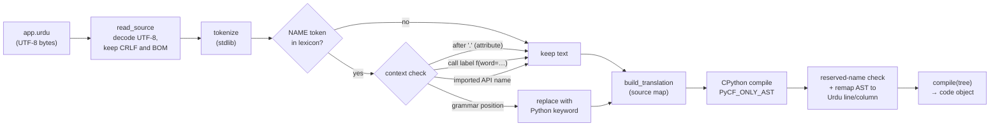
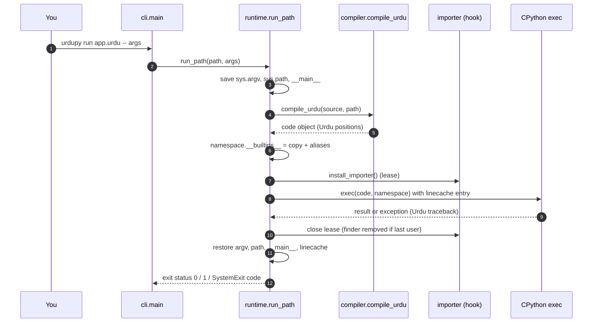
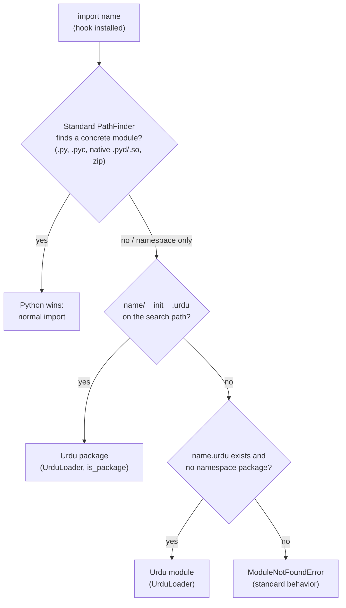

# Architecture: how UrduPy is built and how it runs

UrduPy is a **frontend**, not a new language runtime. It turns Urdu keywords into
Python keywords, asks CPython to parse and compile the result, and then runs the
ordinary code object in the same interpreter that runs every other Python
program. Everything after `compile()` is plain CPython: objects, exceptions,
imports, NumPy arrays, PyTorch tensors and native extensions.

  

## 1. Package map

All runtime code is in [`urdupy/`](../urdupy) and uses only the standard library.

| Module | Lines | Responsibility |
|---|---:|---|
| [`lexicon.py`](../urdupy/lexicon.py) | 90 | Single registry: 35 hard keywords, 2 contextual keywords (`منتخب`/`صورت`), 15 built-in aliases. |
| [`compiler.py`](../urdupy/compiler.py) | 393 | Tokenizes, applies context rules, validates reserved names, compiles with CPython. Public: `translate`, `translate_with_map`, `parse_urdu`, `compile_urdu`. |
| [`source_map.py`](../urdupy/source_map.py) | 159 | Records every edit as an original ↔ translated span; maps syntax errors and AST positions back to the Urdu source. |
| [`runtime.py`](../urdupy/runtime.py) | 155 | Builds the alias namespace, registers source for tracebacks, executes code, restores `sys.argv` / `sys.path` / `__main__`. Public: `execute_source`, `run_path`. |
| [`importer.py`](../urdupy/importer.py) | 139 | Opt-in `sys.meta_path` finder + `SourceLoader` for `.urdu` modules and `__init__.urdu` packages. Public: `install_importer`, `iter_urdu_modules`. |
| [`repl.py`](../urdupy/repl.py) | 78 | `code.InteractiveConsole` subclass with multiline Urdu input. |
| [`cli.py`](../urdupy/cli.py) | 130 | `urdupy run / translate / check / repl`, UTF-8 streams, exit codes, short Urdu hints. |
| [`__init__.py`](../urdupy/__init__.py) | 24 | Lazy public API; importing `urdupy` installs **no** hooks. |
| `experimental/` | — | The frozen M0 translator, kept only for historical regression evidence. |

Dependency direction is one-way: `cli → runtime → compiler → source_map`, with
`lexicon` shared and `importer` reusing `compiler` + `runtime`. No module imports
NumPy, PyTorch or any third-party package.

## 2. Compile pipeline

Key points, each covered by the core test suite:

- **Strings, comments, docstrings and f-string literal parts are never edited.**
  Only `NAME` tokens can change, so `"اگر ورنہ"` stays a string.
- **Attributes and keyword-argument labels stay intact.** `obj.اگر` and
  `dict(اگر=1)` keep the Urdu spelling because a library may really use that name.
- **Soft keywords are contextual.** `منتخب` becomes `match` only in a block-shaped
  `match` header; `صورت` becomes `case` only inside that block. Elsewhere they
  stay ordinary names.
- **Built-in aliases are not translated.** `دکھاؤ` stays `دکھاؤ` in the output;
  it resolves at run time (section 3). That is why `urdupy translate` prints
  *intermediate* Python, which still needs the UrduPy namespace.
- **Errors point at your Urdu code.** Syntax errors and runtime instruction
  positions are mapped back to the original line and column via the source map.
- **Hard keywords are reserved as bare names.** `from math import اگر` fails with
  a clear message: use `... import اگر بطور x` or a non-reserved name.

## 3. Execution and the alias namespace

The alias mechanism is deliberately simple: each module gets its **own copy** of
`builtins` with extra names that point at the **same objects**
(`دکھاؤ is print`, `حد is range`). Consequences:

- Python's normal lookup order applies: local → global → builtins. A user function
  named `دکھاؤ` shadows the alias, exactly as defining `print` would.
- Aliases never appear in `dir(module)` and are not exported by `from m import *`.
- The process-wide `builtins` module is never modified.

## 4. Two-way imports

- The finder is inserted **just before** `PathFinder` in `sys.meta_path`, and
  only while a lease from `install_importer()` is open. `urdupy run` and the REPL
  open one automatically; a Python program opts in with
  `with install_importer(): ...`.
- `.urdu` modules can `درآمد` Python modules, and Python modules can `import`
  `.urdu` modules once the hook is active. Relative imports, nested packages,
  circular imports, `importlib.reload` and package resources are tested.
- **Third-party libraries are found by CPython, not by UrduPy.** `درآمد torch` is
  `import torch`; the hook declines because `PathFinder` already found a concrete
  module. See [Using Python libraries](python-libraries.md).

## 5. Interpreter state UrduPy touches, and how it restores it

| State | Who changes it | Restored? |
|---|---|---|
| `sys.meta_path` | `install_importer()` | Yes: finder removed when the last lease closes. |
| `sys.argv`, `sys.path`, `sys.modules["__main__"]` | `run_path` | Yes, in `finally`, under a lock. |
| `linecache.cache[filename]` | `source_context`, REPL | Yes, unless user code replaced the entry. |
| Temporary `sys.modules["_urdupy_exec_N"]` | `execute_source` without globals | Yes, previous entry put back. |
| stdin/stdout/stderr encoding | `cli.main` | Yes, reset to the previous encoding. |
| `builtins` module | never | n/a |

UrduPy runs **unrestricted Python**. It is not a sandbox; do not run untrusted
`.urdu` files.

## 6. Where to read next

- Exact grammar and keyword list: [language reference](language-reference.md).
- Translator collision rules and mapping contract: [compiler](compiler.md),
  [ADR-011](adr/011-production-compiler.md).
- Import precedence and namespace decisions: [ADR-013](adr/013-runtime-imports.md).
- Linking NumPy / PyTorch / OpenCV: [Using Python libraries](python-libraries.md).
