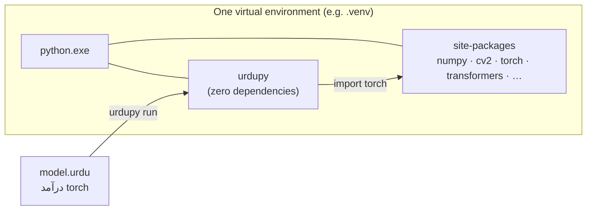

# Using Python libraries (NumPy, OpenCV, PyTorch, …) from UrduPy

**Short version:** there is no binding layer to set up. `درآمد torch` *is*
`import torch`, executed by the same CPython interpreter that runs `urdupy`.
If `python -c "import torch"` works in an environment, then `درآمد torch` works
in that same environment. UrduPy never wraps, renames or re-exports a library.



The only rule that matters: **install UrduPy and your libraries into the same
environment, and run `urdupy` from that environment.**

## 1. Set up an environment

Windows PowerShell, from the `urdupy` checkout:

```powershell
py -3.13 -m venv .venv
.venv\Scripts\Activate.ps1
python -m pip install --upgrade pip
```

Linux/macOS: `python3.13 -m venv .venv` and `source .venv/bin/activate`.
Supported interpreters are CPython 3.12–3.15; scientific wheels may lag behind
the newest Python, so 3.13 is the safest choice for AI work today.

## 2. Pick what to install

| You want | Command | Installs |
|---|---|---|
| Only the language | `python -m pip install .` | UrduPy, nothing else |
| Arrays and images | `python -m pip install ".[science]"` | + NumPy, Pillow, OpenCV (headless) |
| Deep learning | `python -m pip install ".[ai]"` | + torch, torchvision, Transformers, Matplotlib, Urdu plot text helpers |
| Anything else | `python -m pip install pandas fastapi …` | Any pip package, as usual |

The extras pin the exact versions that were tested (NumPy 2.5.4, OpenCV-headless
5.0.0.93, Pillow 12.3.0, torch 2.14.1, torchvision 0.29.1, Transformers 5.19.0).
You don't have to use them: any version you install with pip is what UrduPy imports.

### PyTorch: choose CPU or GPU first

Pip cannot detect your GPU. Install the PyTorch build you want **before** the
`ai` extra; pip keeps it because `+cpu` / `+cu130` builds satisfy the pin.

```powershell
# CPU only
python -m pip install torch==2.14.1+cpu torchvision==0.29.1+cpu --index-url https://download.pytorch.org/whl/cpu

# NVIDIA GPU, CUDA 13.0 (the tested RTX 5060 Ti setup)
python -m pip install torch==2.14.1+cu130 torchvision==0.29.1+cu130 --index-url https://download.pytorch.org/whl/cu130

# then the rest
python -m pip install ".[ai]"
```

For other GPUs or CUDA versions, use the selector at
[pytorch.org/get-started](https://pytorch.org/get-started/locally/).
UrduPy itself never chooses a device or installs drivers.

## 3. Check the link

```powershell
python -c "import sys, torch; print(sys.executable, torch.__version__, torch.cuda.is_available())"
urdupy --version
```

Both commands must use the same environment. If the first prints a path outside
your `.venv`, activate the environment or call `.venv\Scripts\python -m urdupy`.

Then save this as `جانچ.urdu` and run `urdupy run جانچ.urdu`:

```urdu
درآمد numpy بطور np
درآمد torch

صفیں = np.arange(6).reshape(2, 3)
دکھاؤ("NumPy:", صفیں.sum())

آلہ = "cuda" اگر torch.cuda.is_available() ورنہ "cpu"
دکھاؤ("PyTorch:", torch.__version__, "آلہ:", آلہ)
```

## 4. Writing library code in Urdu

Your own names can be Urdu. **Library names stay exactly as the library defines
them**, including Python protocol methods:

```urdu
درآمد torch
سے torch درآمد nn

کلاس چھوٹا_ماڈل(nn.Module):
    فنکشن __init__(self):
        super().__init__()
        self.تہ = nn.Linear(4, 2)

    فنکشن forward(self, x):          # PyTorch calls forward, so keep it
        واپس self.تہ(x)

ماڈل = چھوٹا_ماڈل()
نتیجہ = ماڈل(torch.randn(3, 4, dtype=torch.float32))
دکھاؤ(نتیجہ.shape)
```

| Keep in English | Why |
|---|---|
| `torch`, `numpy`, `cv2`, `transformers` | Real package names on disk. |
| `nn.Module`, `cv2.cvtColor`, `.backward()`, `.state_dict()` | Real attributes of real objects. |
| `__init__`, `forward`, `__len__`, `__getitem__` | The library or Python calls these names. |
| Keyword arguments like `dtype=`, `lr=`, `device=` | They are the function's parameter names. |

Things that are Urdu-friendly: variables, your functions, your classes, attributes
you create (`self.تہ`), file and folder names, and the control flow around it all.

**Rare collision.** If a library exports a name spelled like an Urdu hard keyword,
import it under another name: `سے lib درآمد اگر بطور قدر`. Attribute access
(`lib.اگر`) and keyword arguments (`f(اگر=1)`) already work unchanged.

## 5. Urdu file, folder and module names

Yes, files can be named in Urdu, not only their contents. The STL-10 experiment
already uses this layout: `experiments/ریسنیٹ_ایس_ٹی_ایل۱۰/ماڈل.urdu`,
`تربیت.urdu`, and others.

```text
میرا_منصوبہ/
├── مرکزی.urdu          # درآمد حساب   /   سے اوزار درآمد سلام
├── حساب.urdu           # فنکشن جمع(الف, ب): ...
└── اوزار/
    └── __init__.urdu    # an Urdu package
```

```powershell
urdupy run میرا_منصوبہ/مرکزی.urdu
```

This exact layout was run on Windows / CPython 3.13.13. Python code can also
import `حساب` inside `with install_importer():`.

Rules for an **importable** module or package name (any file name works for
`urdupy run`):

1. It must be a valid Python identifier: Urdu letters, `_`, and digits (Urdu
   digits like `۱۰` are fine) but **no spaces or hyphens**, and it can't start with a digit.
2. It can't be an Urdu hard keyword. `اگر.urdu` exists happily on disk, but
   `درآمد اگر` is a syntax error.
3. A Python module with the same name (`.py`, compiled, or native) wins over the
   `.urdu` file.
4. Spell consistently. Urdu `ی`/`ک` and Arabic `ي`/`ك` are **different
   characters**: `علی` and `علي` are two separate names and two separate files.
5. Urdu file names are verified on Windows. Linux/macOS file systems, archives
   and some Git tools are not yet verified; use ASCII names for shared code if in doubt.

## 6. Troubleshooting

| Symptom | Likely cause | Fix |
|---|---|---|
| `ModuleNotFoundError: No module named 'torch'` | `urdupy` runs from a different environment than pip installed into | Activate the venv, or run `.venv\Scripts\python -m urdupy run file.urdu` |
| `torch.cuda.is_available()` is `False` on a GPU machine | A CPU wheel was installed | Reinstall with the matching `--index-url .../cu130` (or your CUDA) |
| `ImportError` on `cv2`, or two OpenCV versions | Both `opencv-python` and `opencv-python-headless` installed | `pip uninstall opencv-python opencv-python-headless`, then install one |
| `SyntaxError: Urdu syntax word 'X' is reserved` | A variable or imported name equals an Urdu keyword | Rename it, or use `... درآمد X بطور نیا_نام` |
| Model never trains / `forward` not called | `forward` or `__init__` was translated into Urdu | Keep protocol names in English |
| Translated `.py` fails with `NameError: دکھاؤ` | `urdupy translate` emits intermediate Python | Run with `urdupy run`, or `execute_source` |
| Urdu shows as boxes or `?` in the terminal | Terminal font / encoding | Use Windows Terminal or VS Code, and `python -X utf8` |

## 7. Tested combinations

| Library | Version | Evidence |
|---|---|---|
| NumPy | 2.5.4 | AI-001 broadcast/dtype/indexing |
| OpenCV-headless / Pillow | 5.0.0.93 / 12.3.0 | AI-002 color conversion, resize, PNG roundtrip |
| PyTorch (CPU) | 2.14.1+cpu | AI-003 autograd + SGD, XOR training 99.71% held-out |
| PyTorch (CUDA 13.0) | 2.14.1+cu130 | ResNet-18 on STL-10, 77.35% test, RTX 5060 Ti |
| torchvision / Transformers | 0.29.1 / 5.19.0 | Offline ResNet18 and tiny BERT forward passes |

All on Windows AMD64 with CPython 3.13.13. Details and commands:
[AI compatibility](ai-compatibility.md). Other OS/GPU combinations are unverified.
