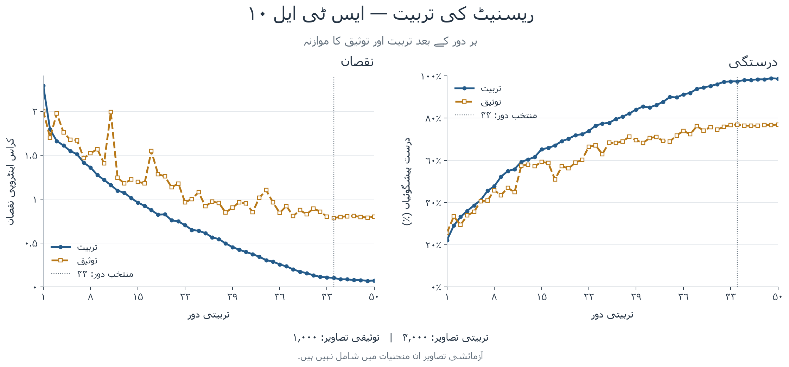
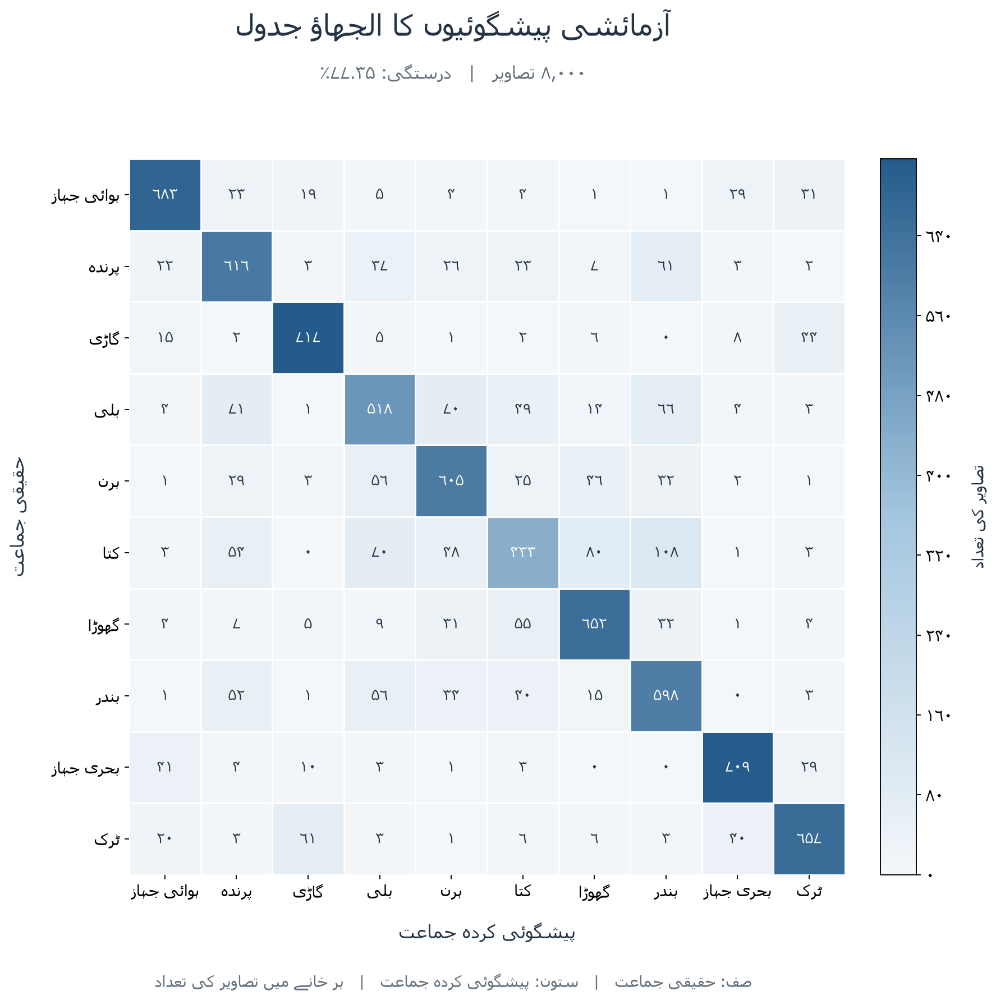
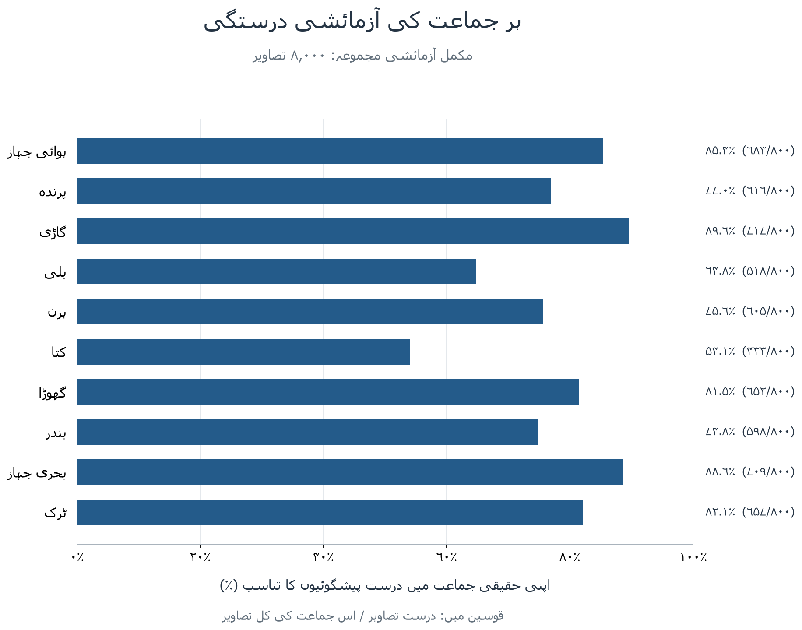
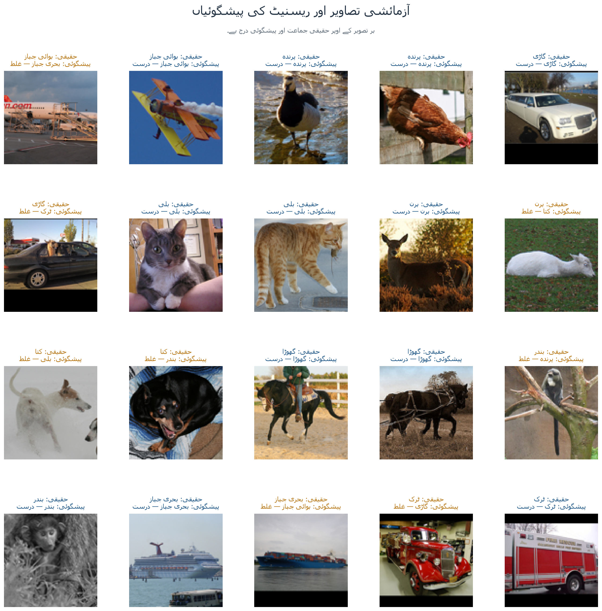

# ریسنیٹ اٹھارہ: اصل تربیت اور نتائج

محفوظ اصل تجربے میں **۸٬۰۰۰ آزمائشی تصاویر میں ۶٬۱۸۸ درست پیشگوئیاں** ہوئیں:
**درستگی ۷۷٫۳۵٪**۔ یہ دس فولڈ کی اوسط نہیں، ایک مقررہ الگ تربیتی و توثیقی
تقسیم کے بعد اصل آزمائشی حصے کا نتیجہ ہے۔ تیار وزن استعمال نہیں ہوئے۔

| پیمانہ | اصل مقدار |
|---|---|
| اعدادی مجموعہ | ایس ٹی ایل ۱۰ |
| بناوٹ | ریسنیٹ اٹھارہ، چار منزلیں، ہر منزل میں دو بنیادی بلاک |
| پیرامیٹر | ۱۱٬۱۷۳٬۹۶۲ |
| تصویر | ۹۶ × ۹۶، تین رنگ |
| تربیتی / توثیقی / آزمائشی تصاویر | ۴٬۰۰۰ / ۱٬۰۰۰ / ۸٬۰۰۰ |
| دور / بیچ / تخم | ۵۰ / ۶۴ / ۴۲ |
| بہترین منتخب دور | ۴۴؛ زیادہ سے زیادہ توثیقی درستگی کا پہلا دور |
| بہترین توثیقی درستگی | ۷۷٪ |
| آزمائشی درستگی | ۷۷٫۳۵٪ |
| آزمائشی نقصان | ۰٫۷۵۶۰۶ |
| تربیتی نقصان، پہلا → آخری دور | ۲٫۲۸۹۶۳ → ۰٫۰۷۳۵۸ |
| آخری تربیتی درستگی | ۹۸٫۷۵٪ |
| تربیت کا وقت | ۱٬۴۳۲٫۱۶ ثانیے، تقریباً ۲۳٫۹ منٹ |
| آلہ | سولہ گیگابائٹ والا آر ٹی ایکس ۵۰۶۰ ٹی آئی |

ابتدائی شرح ۰٫۰۵، رفتار کی یادداشت ۰٫۹ اور وزن کا زوال ۰٫۰۰۰۵ تھا۔ شرح
کوسائن ترتیب سے کم ہوئی۔ اوسط، انحراف، اتفاقی تراش اور افقی پلٹ صرف تربیتی
حصے سے متعلق تھے۔ بہترین دور توثیق سے منتخب ہوا؛ آزمائشی نشان اس انتخاب میں
استعمال نہیں ہوئے۔

## تربیتی اور توثیقی منحنیات

[قابل توسیع خاکہ](تربیتی_خاکے.svg) · [پچاس ادوار کا اصل عددی جدول](تربیتی_تاریخ.csv)

## الجھاؤ جدول

ہر سطر اصل جماعت اور ہر ستون متوقع جماعت ہے۔ ہر اصل جماعت میں ۸۰۰ تصاویر
ہیں۔ ترچھی لکیر کی گنتیوں کا مجموعہ ۶٬۱۸۸ ہے۔

[قابل توسیع خاکہ](الجھاؤ_جدول.svg)

## ہر جماعت کی درست پیشگوئیاں

[اصل جماعتی جدول](جماعتی_نتائج.csv) · [قابل توسیع خاکہ](جماعتی_درستگی.svg)

## تصویری مثالیں

[قابل توسیع خاکہ](پیشگوئیاں.svg)

## ماخذ اور تصدیق

یہ چھوٹا عوامی خلاصہ محفوظ اصل تربیت کے اعداد اور چاروں اصل خاکوں سے بنا ہے۔
برآمد کرتے وقت چار اصل اعدادی فائلوں کے ہاش، تمام آزمائشی نشان کی ترتیب،
تربیتی و توثیقی اشاریوں کی علیحدگی، تمام آٹھ ہزار پیشگوئیاں، بہترین دور کا
انتخاب، اصل ماخذ کے ہاش اور محفوظ وزن کا ہاش دوبارہ ملائے گئے۔

[مشینی خلاصہ اور ہاش](خلاصہ.json) میں عددی ثبوت ہے۔ یہاں مجموعۂ مواد یا بڑے
محفوظ وزن شامل نہیں؛ اصل مقامی نتائج اپنی جگہ محفوظ ہیں۔

یہ اعداد **پہلے سے مکمل پچاس دور کی تربیت** کے ہیں۔ بعد میں بننے والے
[مکمل اردو تربیتی پروگرام](../../../examples/مکمل_اردو/ایس_ٹی_ایل۱۰/README.md)
سے نئے دور چلانے کو الگ نتیجہ سمجھیں۔ نئے اردو ماڈل میں پرانے محفوظ وزن
براہ راست کھلتے ہیں اور اس کی پیشگوئیاں اصل ماڈل کے عین برابر جانچی گئی ہیں۔
